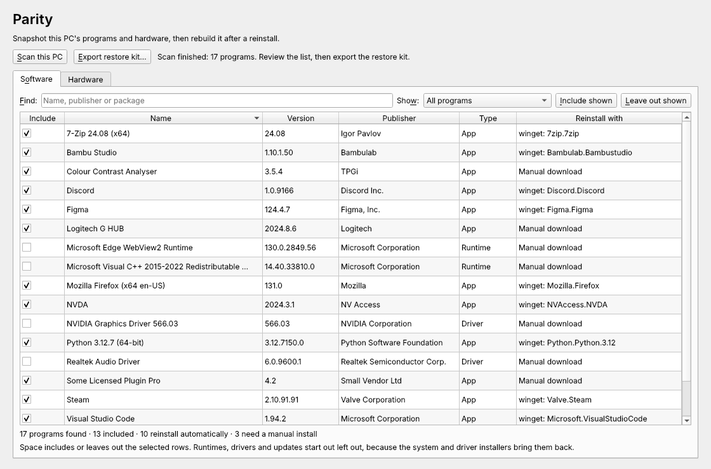

# Parity

Parity takes a snapshot of a computer's installed software and hardware before you reinstall the operating system. It then gives you a script that puts your software back afterwards.

It runs on **Windows, macOS and Linux**. You don't need to install Python or anything else.



## Download

Get the file for your system from the [latest release](../../releases/latest):

| System | File | How to open it |
|---|---|---|
| Windows 10/11 | `Parity-windows-x64.zip` | Unzip it and run `Parity.exe`. If SmartScreen warns you, choose **More info → Run anyway**. |
| macOS (Apple Silicon) | `Parity-macos-arm64.zip` | Unzip it, move `Parity.app` to Applications, and open it. The first time, go to **System Settings → Privacy & Security → Open Anyway**. |
| Linux (x64) | `Parity-linux-x64.tar.gz` | Run `tar -xzf Parity-linux-x64.tar.gz && ./Parity`. Any desktop install already has the libraries it needs. On a minimal system, install `libegl1` and `libxkbcommon0` first. |

The builds aren't code-signed yet, which is why Windows and macOS warn the first time you open them.

## How to use it

1. Choose **Scan this PC** (F5).
2. On the **Software** tab, choose what you want back. Space includes or leaves out the selected rows, and Ctrl/Cmd+F searches. Runtimes, drivers and updates start out unchecked, because they come back on their own.
3. On the **Hardware** tab, check the disk note. It tells you which disk holds the system you're reinstalling and which holds any other OS, so you know what to unplug.
4. Choose **Export restore kit** (Ctrl/Cmd+E), then copy the folder somewhere safe, off the drive you're wiping.
5. After the reinstall, open the kit folder and run the restore script:
   - Windows: right-click `restore.ps1`, then choose **Run with PowerShell**.
   - macOS and Linux: `bash restore.sh`

## What it finds

| | Software it can reinstall automatically | Hardware |
|---|---|---|
| Windows | winget and Microsoft Store packages. Everything else in Apps & features is listed with a download link. | Board, BIOS, CPU, RAM sticks, GPU, disks, network, audio, monitors |
| macOS | Homebrew formulae and casks, and Mac App Store apps (with [`mas`](https://github.com/mas-cli/mas)). Other apps in /Applications are listed. | Model, chip, memory, GPU, displays, volumes, network, audio |
| Linux | Explicitly installed pacman/AUR, apt or dnf packages, plus Flatpak and Snap | Board, BIOS, CPU, RAM, GPU, disks, network, audio |

What's in the restore kit:
- `report.html`: everything on one searchable page, with driver links on Windows
- `restore.ps1` (Windows) or `restore.sh` (macOS and Linux): reinstalls everything it can, then lists what's left for you to install by hand
- `winget-packages.json` (Windows): the same list, for `winget import`
- `software.csv` and `hardware.json`: the raw data

## Privacy

Parity works entirely on your computer and never sends anything over the network. The restore kit does contain your computer's name, network MAC addresses and your list of software, so think before you share it.

## Accessibility

Parity is built to work with a keyboard and a screen reader (Narrator, NVDA, VoiceOver and Orca):
- Every control has a label and a shortcut.
- Checkboxes have accessible names.
- Scan progress is announced.

The HTML report uses real tables and headings and respects dark mode. If something gets in your way, please [open an issue](../../issues).

## Running from source

```sh
pip install -r requirements.txt
python main.py          # or: python main.py --demo   (sample data, any OS)
python test_parity.py   # tests, including a real scan of this machine
```

To build the standalone app yourself: `pip install pyinstaller`, then `pyinstaller --onefile --windowed --name Parity main.py`.

Every push builds and tests on Windows, macOS and Linux through GitHub Actions. Pushing a `v*` tag publishes a release.

## License

MIT. See [LICENSE](LICENSE).
